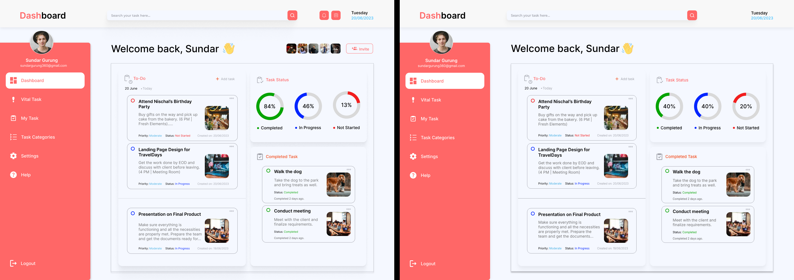

# todo-lab

A hands-on lab for working with Claude Code. Attendees build on a Next.js to-do app taken from the [To-do List Web App Design](https://www.figma.com/design/ANFRy5rLw4kwNQEigIA4sm/To-do-List-Web-App-Design--Community-?node-id=16-35) Figma file, and compare an **A** setup with a **B** setup in each part to see what changes the result.



## What's here

| Path | What it is |
|---|---|
| `base/` | The starting app every lab part copies: the Figma Dashboard screen in Next.js |
| `base-proof/` | Screenshots that prove the base app matches the design and works |
| `DECISIONS.md` | Why the lab is built the way it is |

The seven A/B part folders (Prompt, CLAUDE.md, Skill, MCP, Artifact, Parallel, Proof) are in progress.

## Run the base app

Needs Node 20 or newer and pnpm.

```sh
cd base
pnpm install
pnpm dev        # http://localhost:3000
pnpm test       # unit tests for src/lib/tasks.ts
```

Tasks are saved in the browser's localStorage. To start over, run `localStorage.removeItem("todo-lab.tasks")` in the browser console and reload.

## Stack

Next.js 16.4.3 (App Router), React 19, Tailwind CSS 4.3.3, Vitest, pnpm. Versions are pinned.

## Credits

UI design from the Figma community file linked above. Photos and icons in `base/public/` come from that file.
